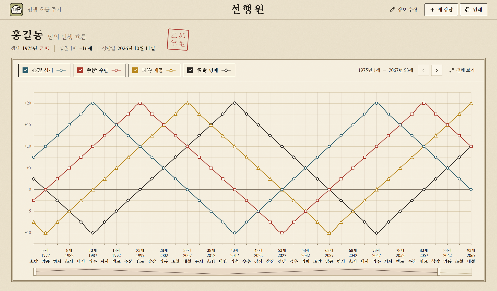
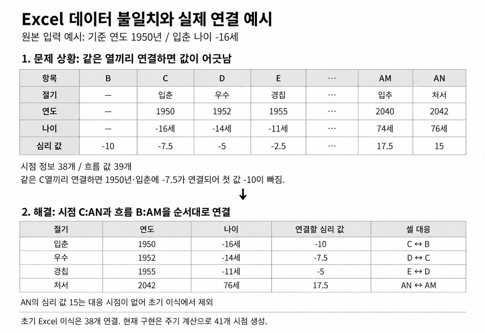
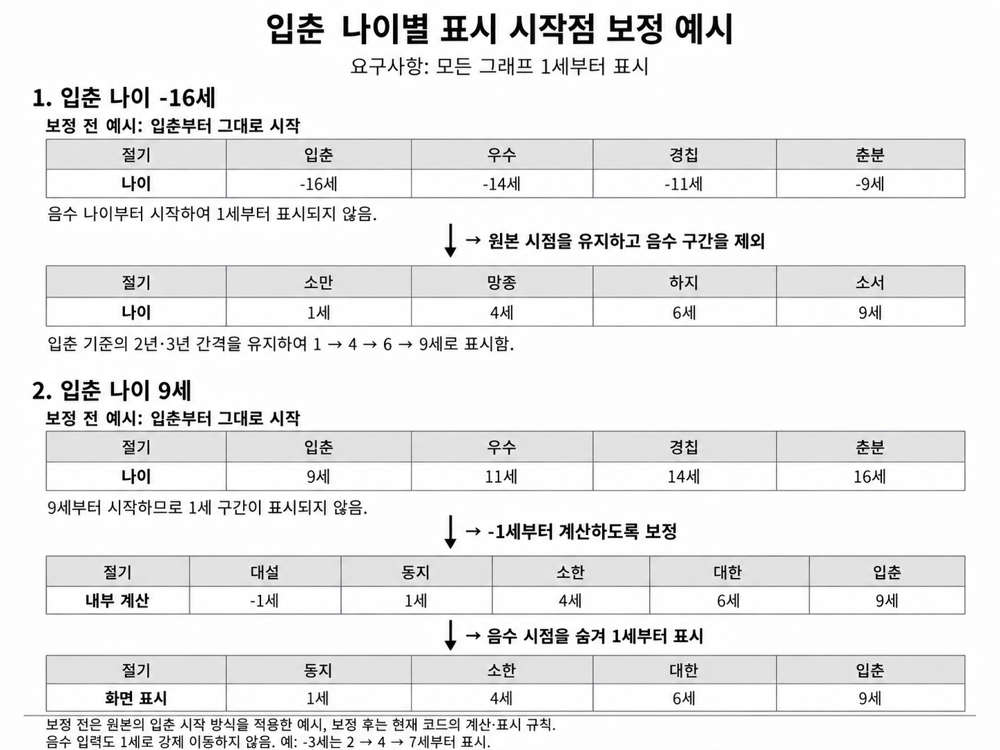
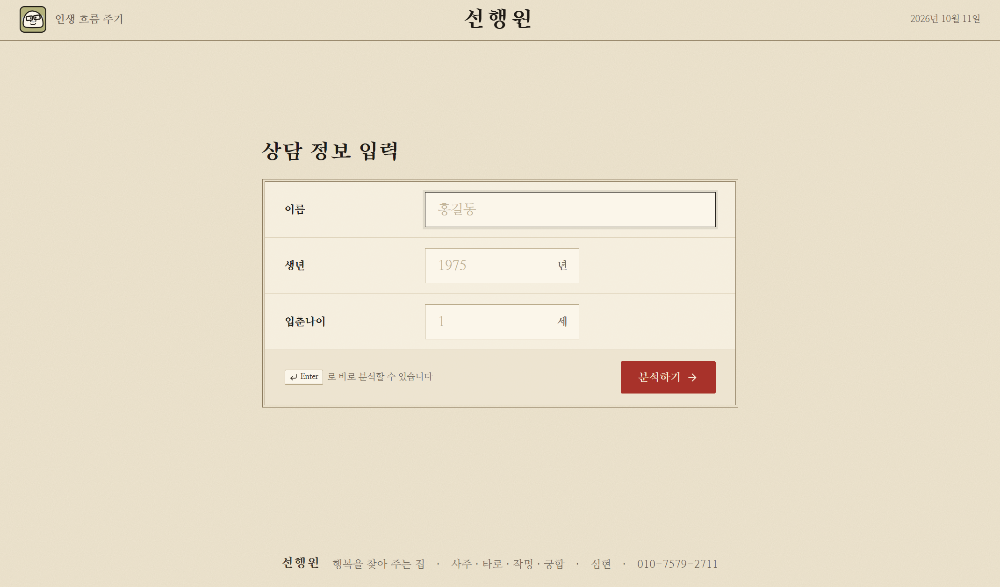
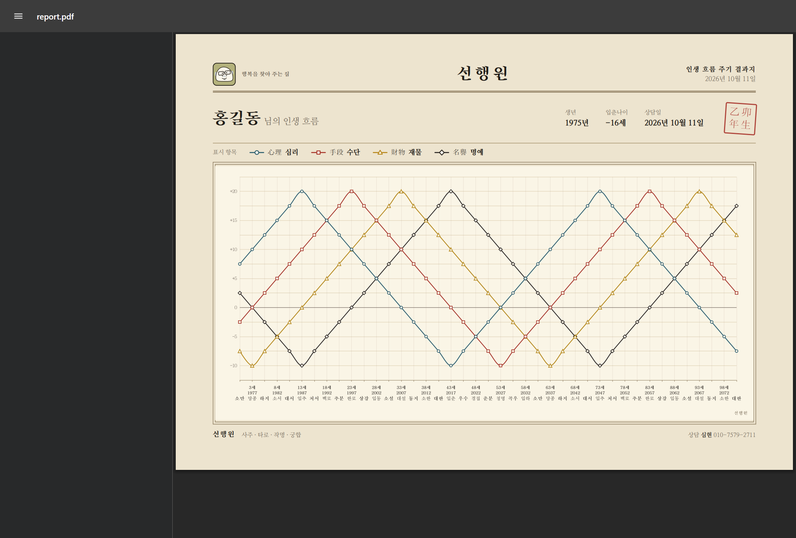

# 사주 상담소 인생 흐름 그래프 제작 프로그램

사주 상담소의 기존 Excel 양식을 분석해 상담 정보 입력부터 그래프 비교, 결과지 저장·인쇄까지 연결한 Windows 기반 상담 프로그램으로,

이름·입춘 기준 연도·나이를 입력하면 심리·수단·재물·명예의 흐름을 계산하여 그래프로 표시해 준다.



<br>

## 프로젝트 개요

| 항목 | 내용 |
| --- | --- |
| 개발 기간 | 2026.9. 말~10. 초, 약 1주. 초기 구현 2일 후 요구사항 협의·수정·검증 진행 |
| 개발 형태 | 실제 상담소 의뢰 기반 1인 개발 |
| 담당 범위 | 요구사항 정의·협의, Excel 분석, 계산·표시 기준 설계, 기능 구현, 검증 및 유지보수 |
| 주요 기술 | React, TypeScript, Electron, Apache ECharts, Vite, Vitest |
| 현장 적용 | 의뢰인 전달용 설치 파일·사용안내서 제공, 현재 상담 현장에서 사용 중 |


<br><br>

## 1. 고객 업무 분석과 요구사항 구체화


<br>

### 1-1. 요구사항 및 대응


기존 엑셀 프로그램 사진

<br>


1. **모든 그래프를 1세부터 표시**

   기존 Excel에서는 그래프 시작점이 고정되어 특정 상황에서 음수 나이부터 표시됨. 의뢰인은 항상 1세부터 보여주기를 희망함. 절기·입춘 정렬 조건을 검토하고, 의뢰인과 협의해 경우별 계산 시작점과 화면 표시 기준을 적용함.

2. **고객에게 보여줄 수 있는 전문성 있는 디자인**

   사주 상담 분야에 맞는 전통적인 디자인으로 입력 화면과 상담 결과 화면을 구성함.

3. **상담 결과를 그대로 전달할 수 있는 저장·인쇄 기능**

   기존에는 그래프를 손으로 그려 고객에게 전송함. 이 작업을 줄이기 위해 상담 결과의 PDF 저장과 인쇄 기능을 구현함.


<br>

### 1-2. 사용 환경을 고려한 추가 개선

| 추가 기능 | 판단 근거·적용 내용 |
| --- | --- |
| Windows 설치형 프로그램 | 의뢰인의 인터넷 사용 부담과 가게 PC 환경을 고려해 로그인·서버 없이 실행하는 방식으로 구성함 |
| 연도별 한자 간지 표시 | 의뢰인이 요청하지 않았던 기능으로, 상담 분야에 맞는 정보 표현과 전문성을 높이기 위해 추가함. 흐름 계산과 분리된 표시용 정보로 관리함 |
| 사용안내서 구성 | 설치부터 사용 과정까지 이해하기 쉽도록 안내서를 제작해 함께 전달 |

<br><br>

## 2. 핵심 문제 해결

<br>

### 1. Excel 시점 정보와 흐름 값의 불일치 분석

<br>

#### 1. 문제 정의 및 원인 파악

첫 번째 시트의 절기·연도·나이 정보는 `C:AN`의 38개인데, 흐름 값은 `B:AN`의 39개로 개수와 시작 열이 달랐음. 같은 열끼리 연결하면 첫 흐름 값이 누락되고 시점과 값의 대응이 어긋남. 원본의 참조 범위와 각 흐름의 시작 위치를 비교하여, 시점 정보와 흐름 값을 열 이름이 아닌 배열 순서로 대응해야 함을 확인함.

<br>



<br>

#### 2. 해결 과정

초기에는 Excel의 시점 정보와 흐름 값의 개수·시작 위치를 맞추는 작업을 진행함. 절기·연도·나이를 나타내는 **시점 정보는 `C:AN`의 38개**, 그래프 높이를 나타내는 **흐름 값은 `B:AN`의 39개**였음. 같은 열끼리 연결하면 첫 번째 흐름 값이 빠지므로, 첫 번째 시점인 C열에 첫 번째 흐름 값인 B열을 연결하고, 다음 시점인 D열에는 C열의 값을 연결하는 방식으로 순서를 맞춤. 이때 숫자 자체를 수정하지 않고, **시점 38개와 흐름 값 38개의 연결 위치를 조정함.** 대응할 시점이 없는 마지막 AN열의 흐름 값은 의뢰인과 합의해 제외함.

<br>

이후에는 입춘나이에 따라 그래프 시작점을 앞당겨 표시해야 했음. 예를 들어 입춘나이가 9세이면 입춘부터 시작하는 그래프는 `9 → 11 → 14세`로 나타나므로, 1세부터 보여주려면 입춘 이전 절기의 흐름 값이 필요함. 원본에는 일부 흐름의 앞부분이 비어 있고 저장된 범위도 한정되어 있어, 기존 38개 값을 그대로 읽는 방식만으로는 시작점 보정과 표시 범위 확장을 함께 처리하기 어려웠음.

<br>

이를 해결하기 위해 **각 시점에 넣을 ‘흐름 값’을 반복 규칙으로 구하도록 변경함.** 원본 심리 흐름에서 확인한 첫 24개 값인 `-10 → -7.5 → -5 → … → 20 → … → -7.5`를 기본 순서로 사용하고, 마지막에 도달하면 다시 첫 값으로 돌아가도록 구성함. 수단·재물·명예도 각각 저장된 38개 배열을 읽는 대신, 같은 기본 순서를 4·8·12칸씩 이동하여 값을 구하도록 변경함. 4칸이 10년에 해당하므로, 심리를 기준으로 수단·재물·명예의 10·20·30년 차이를 유지할 수 있음.

<br>

이 방식에서는 입력한 입춘나이에 맞춰 시작 절기를 정하면, 해당 절기부터 네 흐름의 값을 함께 구할 수 있음. 예를 들어 입춘나이가 9세인 경우, 화면에 표시할 `1세·4세·6세·9세`를 각각 `동지·소한·대한·입춘`에 연결하고, 심리값은 반복 순서에서 찾아 `-2.5·-5·-7.5·-10`으로 배치함. 따라서 시작 나이의 글자만 바꾸는 것이 아니라, **절기와 흐름 값도 함께 이동하여 대응 관계를 유지함.**

<br>

시점 정보는 이와 별도로 확장함. 기존에는 시작점에서 92년 뒤까지의 38개 시점이 있었으나, `95년·97년·100년` 지점을 추가해 **100년 범위의 41개 시점**으로 늘림. 추가한 시점의 흐름 값도 같은 반복 규칙으로 구하므로, 원본 마지막 값 이후까지 이어서 표시할 수 있게 됨.

<br>

결과적으로 **초기 변경은 38개 시점과 39개 흐름 값의 연결 오류를 해결한 것이고, 이후 변경은 시점을 41개로 늘리면서 그 안에 들어갈 네 흐름의 값을 주기적으로 계산하도록 바꾼 것**임. 이를 통해 시작점이 달라져도 흐름 간 간격을 유지하고, 입춘 이전과 원본 범위 이후의 값까지 일관된 규칙으로 구할 수 있게 됨. 다만 원본에서 비어 있던 구간도 반복 규칙으로 채우므로, Excel의 모든 셀을 그대로 복사한 결과와는 차이가 있음.

<br>

#### 3. 결과

초기 데이터의 대응 오류를 해결하고, 현재는 41개 시점을 계산하면서 24절기 주기 반복과 흐름 간 10년 간격을 유지함. 자동 테스트에는 계산 시점 41개, 1세 시작 시 마지막 나이 101세, 주기 반복과 흐름 간격 검증을 반영함. 내부 시작 나이가 -1세인 경우에는 첫 음수 지점을 숨겨 화면에 40개를 표시하고, 0·1세 시작은 41개를 표시함.

초기 38개 이식 기준과 현재 41개 계산 기준은 [초기 판단 기록](docs/decision-log.md),  [주기 데이터](src/constants/cycleData.ts), [계산 테스트](src/logic/calculateConsultation.test.ts)로 구분해 확인할 수 있음.

<br><br>

### 2. “모두 1세부터 표시” 요구와 입춘 정렬 조건의 조율

<br>

#### 1. 문제 정의 및 원인 파악

의뢰인은 음수 나이부터 시작하는 기존 그래프를 모든 경우에 1세부터 표시하기를 요청함. 그러나 절기가 2.5년 주기로 반복되어 시작 나이를 일괄적으로 1세로 설정하면, 입력한 입춘 나이가 입춘 지점에 놓이지 않는 경우가 발생함. 실제로 입춘 나이 7세를 입력했을 때 입춘 지점에 8세가 표시되는 오류를 확인함. 시작점 라벨만 바꾸거나 기준 연도까지 이동하는 방식도 연도·나이·절기의 대응 관계를 어긋나게 하므로, 계산 시작점과 화면 표시 시작점을 함께 검토함.

<br>



<br>

#### 2. 해결 과정

입춘 지점에 입력 나이가 정확히 대응하도록 시작 나이를 정하고, 음수 지점의 화면 노출 여부는 별도로 처리하기로 의뢰인과 협의함. 양수 입춘 나이는 5로 나눈 나머지에 따라 1·0·-1세 중 하나에서 계산을 시작하고, 입춘 나이가 0 이하이면 1세에서 시작하도록 적용함.

| 입력한 입춘 나이 | 내부 계산 시작 | 화면 표시 시작 |
| --- | --- | --- |
| 양수이며 5로 나눈 나머지가 1·3: 1·3·6·8·11·13세 등 | 1세 | 1세 |
| 양수이며 5로 나눈 나머지가 0·2: 2·5·7·10·12·15세 등 | 0세 | 0세 |
| 양수이며 5로 나눈 나머지가 4: 4·9·14·19세 등 | -1세 | 음수 지점을 제외하고 1세 |
| 0 이하: 0·-16세 등 | 1세 | 1세 |

예를 들어 입춘 나이가 -16세이면 기준 연도를 유지하고 시작 절기를 소만으로 보정하여 `1 → 3 → 6 → 8세`부터 계산·표시함.

9세이면 내부적으로 `-1 → 1 → 4 → 6 → 9세`로 계산하되 화면에는 `1 → 4 → 6 → 9세`부터 표시함. 7세처럼 0세 시작이 필요한 경우에는 `0 → 2 → 5 → 7세`를 그대로 표시하고, 음수 나이만 화면에서 제외함.

연도는 입력한 기준 연도가 1세가 되는 해라는 관계를 유지하여 `기준 연도 + 나이 - 1`로 계산함. 음수 지점을 숨긴 뒤에도 그래프·툴팁·탐색 막대가 같은 시점을 가리키도록 내부 인덱스와 표시 인덱스를 변환함.

<br>

#### 3. 결과

입춘 나이 1~15세의 입춘 정렬과 시작 나이·표시 시작점을 자동 테스트로 검증함. -16세 입력은 1세부터 계산·표시하며, 기준 연도 2003년이 시작점 보정으로 2020년으로 이동하지 않는지 회귀 테스트에 반영함. 협의한 기준에 따라 일부 경우에는 0세를 표시하고, -1세에서 계산하는 경우에는 음수 지점을 숨겨 1세부터 표시하도록 구현함.

적용 규칙과 검증 사례는 [계산 로직](src/logic/calculateConsultation.ts), [화면 표시](src/components/FlowChart.tsx), [계산 테스트](src/logic/calculateConsultation.test.ts)에서 확인할 수 있음.


<br><br>

## 3. 기술 선택과 역할

| 기술 | 적용 내용·선택 근거 |
| --- | --- |
| React | 입력·결과·출력 화면 구성, 흐름 선택과 정보 수정 상태 관리 |
| TypeScript | 연도·나이·절기·흐름 데이터와 계산 입출력 구조 정의 |
| Electron | Windows 설치형 앱, 오프라인 실행과 결과지 저장·인쇄 제공 |
| Apache ECharts | 네 흐름 비교, 표시 선택, 툴팁, 구간 확대·이동 구현 |
| Vite | 개발 환경과 배포용 화면 빌드 구성 |
| Vitest | 계산 로직의 경계값·회귀 테스트 자동화 |

사용 장소와 사용자가 한정된 환경을 고려해 중앙 서버와 로그인 없이 실행하는 방식을 선택함. 계산 기준은 로직에서 관리하고, 화면 표시와 결과지 출력은 각각의 용도에 맞춰 구성함.

<br><br>

## 4. 검증

Excel 첫 번째 시트의 연도·나이·24절기와 네 흐름 값을 비교해 초기 계산 기준을 확인함. 이후 합의한 개선 규칙은 자동 테스트와 실제 화면·출력 검증으로 확인함. 초기 Excel 비교와 현재 변경 규칙의 검증은 구분함.

| 검증 영역 | 확인 내용 | 기록된 결과 |
| --- | --- | --- |
| 계산 경계값 | -16세 입력, 입춘 나이 1~15세, 2003년 연도 보정 | 관련 자동 테스트 통과 |
| 계산 관계 | 10년 간격 유지, 24절기 반복, 연도·나이 정렬 | 관련 자동 테스트 통과 |
| 입력 처리 | 이름 공백 제거 | 관련 자동 테스트 통과 |
| 화면 | 화면 캡처를 통한 결과 표시 확인 | 최종 테스트 보고서상 통과 |
| 결과지 | PDF·PNG 생성, A4 가로 인쇄용 레이아웃 | 최종 테스트 보고서상 통과 |
| 배포 구성 | 설치 파일과 ZIP 구성 | 최종 테스트 보고서상 통과 |

2026.10.11. 기록 기준 `npm test` 실행 결과 1개 파일·34개 테스트 통과. 자동 테스트는 계산 규칙을 검증하며, 화면·출력·배포 검증은 별도로 진행함. 인쇄용 결과지 검증과 실제 프린터 출력 검증은 구분해 관리함.

<br><br>

## 5. 성과 및 의뢰인 피드백

<br>

### 5.1. 추가된 기능과 개선 성과

| 추가·개선한 기능 | 개선된 업무 |
| --- | --- |
| 심리·수단·재물·명예 통합 그래프와 개별 선택 | 네 시트의 그래프를 한 화면에서 비교하고, Excel의 행 숨김·표시 작업을 흐름 선택으로 대체함 |
| 시작 나이 보정과 음수 시점 숨김 | 합의한 기준에 따라 0세 또는 1세부터 표시하여 상담에 필요한 구간을 보여줌 |
| PDF·PNG 저장과 인쇄 | 손으로 그래프를 그려 카카오톡으로 보내던 작업을 결과지 저장 후 전송하는 방식으로 개선함 |
| 연도별 한자 간지와 상담소 브랜딩 | 상담 분야에 맞는 정보를 추가하고, 화면과 결과지에 상호·로고를 적용함 |
| Windows 설치 파일과 사용안내서 | Excel 설치나 웹 접속 없이 가게 PC에서 실행할 수 있도록 제공함 |

2026.10.2. 의뢰인 전달용 설치 파일과 사용안내서를 준비하고, 2026.10.4. v0.1.2 설치 파일을 생성함. 프로그램은 현재 상담 현장에서 사용 중임.

<br>

### 5.2. 의뢰인 반응

- 의뢰인은 요청하지 않았던 화면·결과물 정리와 연도별 한자 간지 표시가 상담의 전문성을 높였다고 평가함. 또한 결과지를 저장해 전달할 수 있게 되면서, 기존에 그래프를 직접 그려 보내던 작업보다 전달에 드는 시간이 크게 줄었다고 피드백함.

<br>

### 주요 화면



<br>



이미지는 예시 고객 정보를 사용한 화면임.

<br><br>

## 6. AI 도구 활용과 직접 수행한 판단

개발자는 문제 정의, 기능·디자인 요구사항, 계산·표시 기준 협의와 검증 기준을 담당함. AI 도구는 Excel 구조 분석, React·TypeScript·Electron 코드 작성, UI 개선, 테스트 케이스 작성과 문서 정리에 활용함.

<br>

AI가 생성한 결과는 Excel 원본 비교, 자동 테스트, 실제 화면 캡처, PDF·PNG 출력과 설치 파일 검증으로 확인함. 데이터 대응과 입춘 정렬처럼 해석이 필요한 기준은 의뢰인과 협의해 결정하고 검증에 반영함.

<br><br>

## 7. 실행과 빌드

```bash
npm install
npm run dev
```

개발 서버 기본 주소: `http://127.0.0.1:5173`.

<br>

```bash
npm test
npm run typecheck
npm run build
```

<br>

Windows 설치 파일 생성:

```bash
npm run dist
```

설치 파일은 `release` 폴더에 생성됨.

<br><br>

## 관련 문서와 향후 관리

- [Excel 분석](docs/excel-analysis.md)
- [판단 기록](docs/decision-log.md)
- [화면 재설계 기준](docs/ui-redesign-handoff.md)

초기 분석 문서의 38개 시점과 현재 41개 주기 계산의 차이를 유지보수 문서에도 반영함. 후속 수정은 발생 상황·원인·변경 내용·적용 버전·재검증 결과를 함께 기록하고, 현장 피드백에 따라 글자 크기·그래프 탐색·출력물 가독성을 개선할 예정임.
